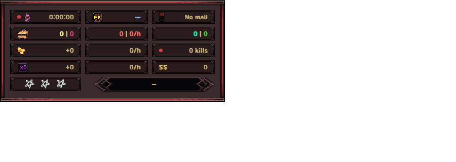

# HS Tracker

Track gold, XP, kills and drops while you play Hero Siege. Use the compact in-game overlay for live numbers and the dashboard for runs, item alerts, collection and the [world map](https://parazeya.github.io/hs-map/).

> [!IMPORTANT]
> **Check that the GitHub repository owner is Parazeya before downloading.** According to the maintainer, PAS QA team member **Fumacinhahs** reviewed and approved the original project. The HS Tracker maintainers take no responsibility for third-party forks, repositories or releases. [Original HS Tracker repository](https://github.com/Parazeya/hs-tracker)

## Download

<!-- downloads -->
<table align="center">
  <tr>
    <td><b>Windows</b></td>
    <td><a href="../../releases/download/v1.1.16/HS.Tracker_1.1.16_x64-setup.exe">HS.Tracker_1.1.16_x64-setup.exe</a></td>
  </tr>
  <tr>
    <td><b>Linux · AppImage</b></td>
    <td><a href="../../releases/download/v1.1.16/HS.Tracker_1.1.16_amd64.AppImage">HS.Tracker_1.1.16_amd64.AppImage</a></td>
  </tr>
  <tr>
    <td><b>Linux · deb</b></td>
    <td><a href="../../releases/download/v1.1.16/HS.Tracker_1.1.16_amd64.deb">HS.Tracker_1.1.16_amd64.deb</a></td>
  </tr>
  <tr>
    <td><b>Linux · rpm</b></td>
    <td><a href="../../releases/download/v1.1.16/HS.Tracker-1.1.16-1.x86_64.rpm">HS.Tracker-1.1.16-1.x86_64.rpm</a></td>
  </tr>
</table>
<!-- /downloads -->

- **Windows** — Run the installer and install [Npcap](https://npcap.com/) with its default options. Leave the administrator-only option unchecked.
- **Linux** — Install the .deb on Debian or Ubuntu, or the .rpm on Fedora for live tracking. The AppImage can open the dashboard. The overlay and global shortcuts require X11 or XWayland. [Linux installation guide](LINUX.md)
- **Updates** — Open **About** to check for updates. If you're on **1.1.15 or older**, download and install the new version manually. Later Windows and AppImage builds can update from **About**.

## Start playing

1. Open HS Tracker, then enter a zone with your character. Tracking starts after you join a game server.
2. Open **Alerts** to choose which drops play a sound or show an announcement.
3. Enable tracking for your character in **Collection**. Use **Import Check List** to bring in older finds from a supported Google Sheets link or Excel file.

| Action | Shortcut |
| --- | --- |
| Show or hide Tracker | Tray icon or Ctrl+Shift+O |
| Switch between overlay and dashboard | **Compact mode** in the sidebar or **Dashboard** in the overlay menu |
| Lock the overlay so clicks go to the game | Ctrl+Shift+L |
| Reset or pause the session | Ctrl+Shift+R or Ctrl+Shift+P |
| Open or close the world map | Ctrl+Shift+M |

For OBS, add **Window Capture** and select the Tracker window you want on stream. Keep that window open during capture. [OBS Window Capture guide](https://obsproject.com/kb/window-capture-sources)

## Troubleshooting

- **Counters stay at zero** — Enter a zone and check that Npcap or the native Linux package is installed. If you use ExitLag, try **Read every connection** in Tracker's Settings.
- **Settings do not save** — On Windows, install Tracker in a folder your account can write to. **About** can open the folder containing the settings and the log.
- **The overlay is hidden behind the game** — Try running Hero Siege in borderless or windowed mode.

[Development guide](DEVELOPING.md) · [MIT license](LICENSE)

Hero Siege art © Panic Art Studios. HS Tracker is a community project. It builds on [hero-siege-stats](https://github.com/GuilhermeFaga/hero-siege-stats) and [Hero-Siege-Companion](https://github.com/DemonSkye/Hero-Siege-Companion).
