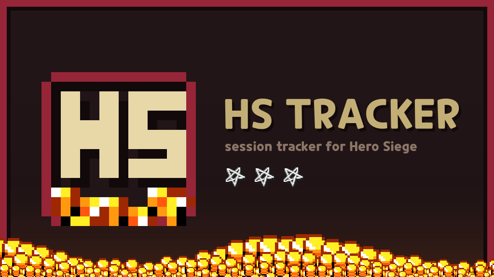
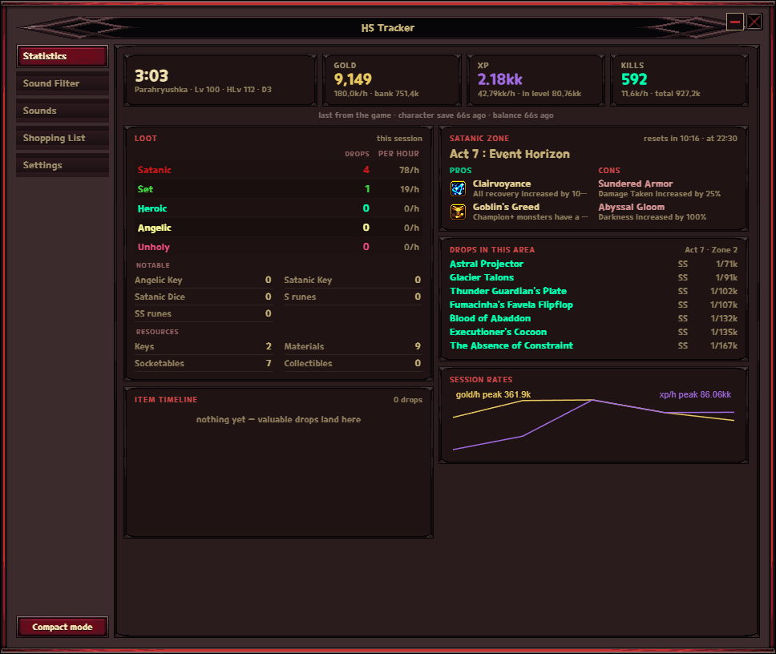
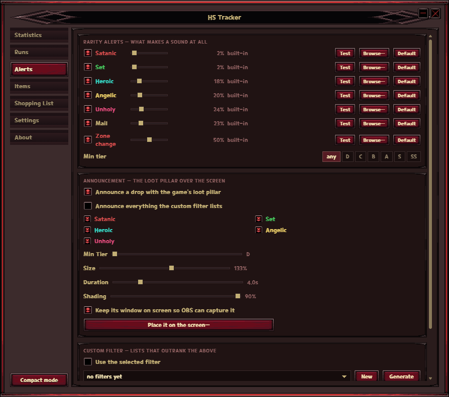
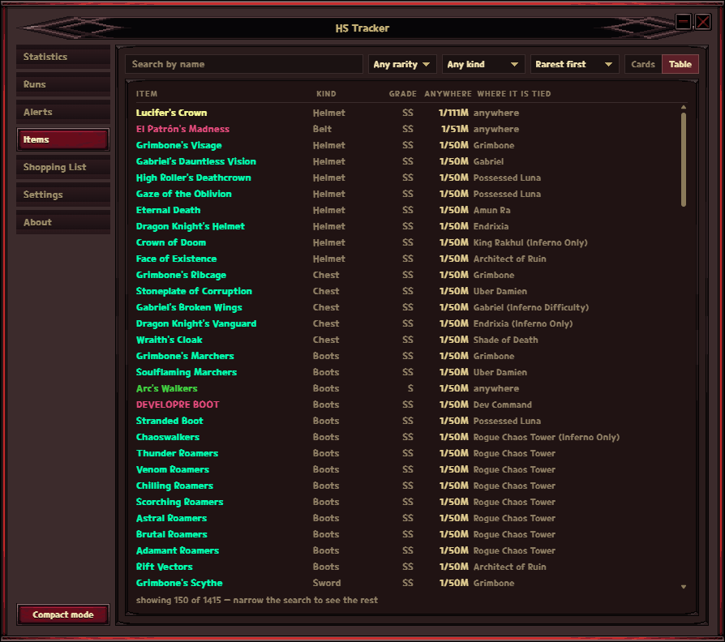
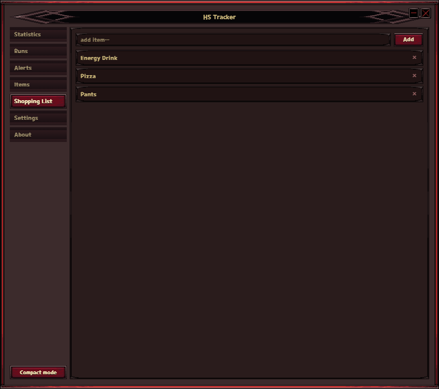
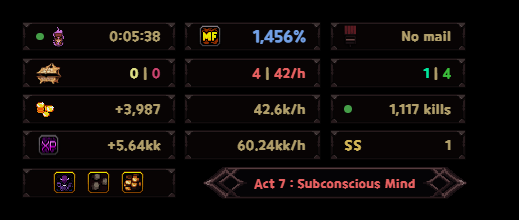
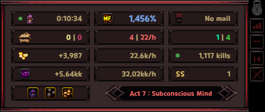
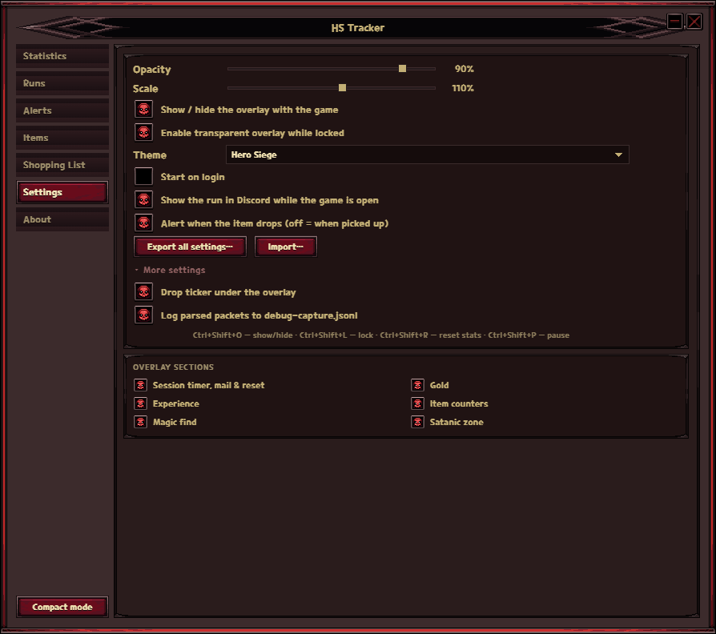

<p align="center">
  
</p>

<p align="center">
  Gold, experience, kills and every drop — counted while you farm,
  <br>in the game's own skin.
</p>

<h3 align="center">Approved by the developer of Hero Siege</h3>

<p align="center">
  <a href="../../releases"><b>➡️ Download for Windows &amp; Linux ⬅️</b></a>
</p>

<p align="center">

  <a href="../../releases"></a>

</p>


<!-- downloads -->
<table align="center">
  <tr>
    <td><b>Windows</b></td>
    <td><a href="../../releases/download/v1.1.16/HS.Tracker_1.1.16_x64-setup.exe">HS.Tracker_1.1.16_x64-setup.exe</a></td>
  </tr>
  <tr>
    <td><b>Linux · AppImage</b></td>
    <td><a href="../../releases/download/v1.1.16/HS.Tracker_1.1.16_amd64.AppImage">HS.Tracker_1.1.16_amd64.AppImage</a></td>
  </tr>
  <tr>
    <td><b>Linux · deb</b></td>
    <td><a href="../../releases/download/v1.1.16/HS.Tracker_1.1.16_amd64.deb">HS.Tracker_1.1.16_amd64.deb</a></td>
  </tr>
  <tr>
    <td><b>Linux · rpm</b></td>
    <td><a href="../../releases/download/v1.1.16/HS.Tracker-1.1.16-1.x86_64.rpm">HS.Tracker-1.1.16-1.x86_64.rpm</a></td>
  </tr>
</table>
<!-- /downloads -->

> [!NOTE]
> **How soon does it work when a new season starts?**
>
> About an hour, an hour and a half. That is how long it takes to rebuild the
> item tables and cut a release.


## What it does

| | |
| --- | --- |
| **Overlay** | A small always-on-top panel with the run so far. Lock it and it becomes click-through, so it never eats a click meant for the game. |
| **Statistics** | Gold, xp and kills per hour, drops by rarity, magic find, bosses and chests, what rolls better in the zone you are standing in, and the Satanic Zone with a countdown to the next rotation. |
| **Alerts** | One page: a sound per rarity, the grade a drop must reach, named lists of specific items with sounds of their own, the satanic zone rotating, and the announcement — all set side by side rather than three tabs apart. Alerts fire the moment an item hits the ground. |
| **Announcement** | A drop lands and the game's own loot pillar plays over the screen, wherever you have put it. It can follow the rarity switches or simply announce whatever your custom filter lists. |
| **Satanic Zone** | The rotation gets a chime and an announcement of its own — a rift that opens across the screen with the new zone and the buffs it rolled, drawn so it is never mistaken for a drop. Tick the buffs worth leaving a fight for and the rest pass in silence; tick none and every rotation is announced. |
| **Items** | Every named item, its drop chance, and the places it rolls better in. Search by name, rarity or kind. |
| **Collection** | Add characters to one shared collection by turning tracking on for each of them. Browse unique equippable gear, including charms and flasks; filter found and missing items, see totals by rarity, and open an item to see its drop chances and locations. A popup announces each new name. Jewels, relics and other non-equipment are excluded. Turning a character off keeps the progress. |
| **Runs** | Every finished session kept — the rates, the finds, where the time went. **Copy card** turns one into a picture you can paste into a chat. |
| **Pause** | By hand, or by itself after five quiet minutes, so a break does not end up in the per-hour figures. |
| **OBS** | Independent Browser Sources for statistics, notifications, recent drops and the current map view. |
| **Backup** | Export every setting — rarities, grades, the announcement, every filter and list, and the sound files themselves — to one file, and read it back on another machine. |
| **About** | The version you are running, who made it, and a button that asks GitHub whether a newer release is out. |
| **Discord** | Optional: while the game is open, your friends see the zone, the drops and the timer. |

## Where the numbers come from

It listens to the game's own network traffic, with the same packet-capture
library `tcpdump` and Wireshark use — Npcap on Windows, libpcap on Linux. The
game already tells its server about every drop, every deposit and every save.
This reads that conversation going past and counts what is in it.

It never touches the game. Nothing is injected, no memory is read, no file of
the game's is opened, and nothing about it is modified. What it does with the
game process is ask the operating system two things — whether it is running, and
which servers it holds connections to — which are the two questions Task Manager
and `netstat` already answer for anyone who asks them.

The capture is narrowed to the game's own servers: the app asks the operating
system which addresses the game is connected to and listens to those, so the
rest of what your machine is doing is never looked at. There are setups where
that cannot work — a route optimiser such as ExitLag redirects the game's
packets below the level Windows reports them at, so the addresses it names are
not the ones on the wire, and nothing is counted at all. **Read every
connection** in Settings takes the filter off for those machines. That widens
what is read on your own machine and changes nothing else.

A game accelerator that works the other way — the game connects to `127.0.0.1`
and the accelerator carries it on from there — needs nothing switched on. The
game's own traffic is then on the loopback adapter and nowhere else, so that
adapter is listened to for as long as the game has no connection of its own to a
server, and the filter stays off while it does.

Nothing is sent anywhere; every number stays where it was counted. Two things
leave the machine, both only if you ask for them: the **About** section's update
check, which asks GitHub for the newest release when you press the button, and
Discord rich presence, which hands the zone, the drop count and the session
clock to the Discord client while it is switched on. It is off until you turn it
on.

## Showcase

The app is a small set of pages behind the overlay: what happened this session,
what to shout about when it drops, what you are hunting, and the switches.

| Statistics | Alerts |
| --- | --- |
| Rates per hour, drops by rarity and grade, magic find, bosses and chests, and the Satanic Zone with its countdown. | One page in two columns: each rarity's sound and volume on the left with the announcement under it, the custom filter and its lists on the right. |
|  |  |

| Items | Shopping List |
| --- | --- |
| Every named item, what it takes to get one, and where it is worth farming. Cards or a table, whichever reads better. | The items you are actually after, so a drop you have been waiting weeks for is not one line among forty. |
|  |  |

### The overlay, locked and not

Locked, it is click-through: the mouse goes to the game and only the numbers are
drawn. Unlocked, it grows a frame, a grip to drag it by and the buttons that
reset or hide it — and that is the one state in which it can take a click the
game was meant to have.

| Locked | Unlocked |
| --- | --- |
|  |  |

Settings is the last page, and the least interesting: the four or five things
people change, with the rest a click away under **More settings**.




## Install

### Windows

Run the installer. It installs for the current user, so Windows never asks for
administrator rights.

The standard build needs [Npcap](https://npcap.com) to read the game's traffic. The
installer checks for it and opens the download page when it is missing. Install
it with the options it comes with, and in particular leave *Restrict Npcap
driver's access to Administrators only* unticked — with that on, HS Tracker is
refused the adapter and counts nothing.

An experimental portable build can use Windows Packet Monitor without Npcap.
It requires administrator privileges and is still awaiting live game capture
validation; see [CAPTURE-BACKENDS.md](CAPTURE-BACKENDS.md) for its limits and
build options.

Everything the app writes lives next to the executable, so the folder can be
copied to another machine as it is.

### Linux

Use a native package for live tracking, and start Tracker as your normal user:

```bash
sudo apt install ./HS\ Tracker_*_amd64.deb      # Debian, Ubuntu, Mint …
sudo dnf install ./HS\ Tracker-*.x86_64.rpm     # Fedora
```

These packages grant the executable its capture capability during installation.
Settings live in `~/.config/hs-tracker`.

For **Arch Linux and Manjaro**, build a native package on the target distribution
with [scripts/package-arch.sh](scripts/package-arch.sh), as described in
[LINUX.md](LINUX.md). A binary built on current Arch is not a universal Manjaro
artifact because their library versions can differ. Debian's libpcap soname also
differs from Arch's, so unpacking the `.deb` is not an Arch installation method.

The AppImage is an alternative for opening the dashboard. It needs a working
FUSE setup, or `APPIMAGE_EXTRACT_AND_RUN=1`; this only addresses startup. Its
launcher cannot retain the file capability required for capture, so use a native
package for the live numbers. The packaging step preserves the user's GTK
backend choice and excludes host-owned Wayland/XCB libraries.

Native Wayland can show the dashboard. The overlay and global hotkeys require
X11/XWayland; see [LINUX.md](LINUX.md) for the tested cases and remaining limits.

### Updates

HS Tracker looks for a newer version when it starts and puts a dot on the
**About** tab when it finds one. The tab shows what that version changes and
installs it on a click; nothing is downloaded before that. The Windows installer
and the AppImage update themselves — a `.deb` or `.rpm` is replaced the way the
package manager replaced it in the first place.

## Using it

The tray icon is the control centre: click it to hide or bring back whatever was
last on screen. The overlay carries its own strip of icons down the right-hand
edge for the same things.

| | |
| --- | --- |
| Show / hide | tray click, or `Ctrl+Shift+O` |
| Overlay ⇄ dashboard | **Compact mode** in the sidebar, **Dashboard** in the overlay menu |
| Lock the overlay | the lock icon on hover, or `Ctrl+Shift+L` |
| Reset the session | the overlay button, the tray, or `Ctrl+Shift+R` |
| Pause the session | the clock in Statistics, the tray, or `Ctrl+Shift+P` |
| Full-screen world map | `Ctrl+Shift+M`, or **Open full-screen map** in Settings |

The map opens the bundled current [hs-map](https://parazeya.github.io/hs-map/) on the current screen.
Press `Ctrl+Shift+M` again or use the red **×**
at the top right to hide it; reopening keeps your position. **Reload map**
reloads the packaged map. On Wayland, use the Settings button when global
shortcuts are unavailable.

Counting starts once the game reports your character, a moment after you enter a
zone. Cumulative gold, experience and kills arrive with saves; explicit gold
and XP gains may arrive between them. An XP gain inferred only from a save
waits for a second compatible reading, so a single bad read cannot inflate
XP/hour. Drops arrive continuously; these counters do not all advance together.

Open **Collection** after the game reports your character and switch tracking
on for it. Add other characters the same way when you play them. Their finds
build one shared collection; the character rows can be expanded to see each
one's contributions. Only unique equippable gear is counted. Finds are stored
in `collection.json` beside the other app data and included in settings
backups. Items found before tracking was
switched on cannot be reconstructed from the game's traffic later.
To bring in older finds, use **Import Check List**. Paste a viewable Google
Sheets link to your copy of the hcjobo checklist, or download it as an `.xlsx`
file and choose that file. Review the matched and skipped names, select a
character, then import. Matching checks the item's name, rarity and equipment
slot against Tracker's catalogue. Existing finds are kept; importing again
does not duplicate them or turn live tracking on.
Use the `+` or `−` button beside an item to add it for a chosen character or
remove it from the shared collection. Each manual edit asks for confirmation.
Click an item in the collection to see its general and location-specific drop
chances and the places where it can drop.
Use **Clear history** to reset finds while keeping the characters and their
tracking switches. Expand a character to clear only their finds or remove them
from the collection. **Remove all characters** clears the roster and its finds.

## Streaming it

Open **Streaming**, enable **Browser Sources**, then add a **Browser** source
in OBS for each part you want. Copy its URL from Tracker and use 30 FPS.

| Source | Default URL | Suggested size |
| --- | --- | --- |
| Statistics | `http://127.0.0.1:17265/stats` | 480 × 380 |
| Notifications | `http://127.0.0.1:17265/notifications` | 960 × 540 |
| Recent drops | `http://127.0.0.1:17265/drops` | 480 × 300 |
| Map view | `http://127.0.0.1:17265/map` | 1280 × 720 |

The sources stay live while Tracker is hidden or minimized. They are silent;
Tracker plays the audio once. **Test notification** checks the OBS path without
changing your session or collection. Sources reconnect and receive the latest
state after a scene reload or Tracker restart; expired notifications do not replay.

The map source mirrors the map view in Tracker: position, zoom, room selection,
search, language and selected source. Different OBS proportions add margins to
preserve the view. It does not show the desktop cursor, hover tooltips or other
Tracker pages. Open the map once to choose its view; hiding it leaves that view
available to OBS.

Only the loopback interface is used. The HTTP service serves packaged assets
and read-only stream data; it has no control endpoints. A port conflict appears
in Streaming. Choose another local port there and update the URLs in OBS.

## If something does not work

**Nothing you change sticks.** The app keeps its settings in its own folder,
beside the exe. Installed somewhere Windows will not let it write — under
Program Files — every save fails, so no setting on the page does anything: the
theme does not change, a filter does not stick, and the app used to say nothing
about it. Move the folder somewhere of your own, or start it as administrator.
`hs-tracker.log` says `READ-ONLY` beside the folder when this is the case.


**Send the log.** The app writes what goes wrong to `hs-tracker.log` beside its
settings — panics, anything a panel throws, and, when nothing is being counted,
what the capture actually saw. **About** gives the path and a button that opens
the folder.

It is meant to be pasted into a chat, so it is worth knowing what is in it:
which version started, which Windows and which WebView2, where the app is
installed, the names of your network adapters, and the addresses of the game's
servers it is filtering on. No account name, no character, nothing the game
said. The install path is the one line that can carry your Windows username, if
that is where you put it.

`debug-capture.jsonl`, in the same folder, is a different thing. It is the
packet log from Settings, off unless you switch it on, and it holds what the
game actually sent: your account id, your character, your addresses. Do not
paste that one anywhere you would not paste your account name.

**The numbers stay at zero.** First, the app has to be allowed to read network
traffic: on Windows that means Npcap, on Linux the packaged install grants it
and an AppImage cannot be granted it at all — see above. Npcap's own installer has a
box marked *Restrict Npcap driver's access to Administrators only* — ticked, it
refuses HS Tracker the adapter, and the app says so rather than claiming Npcap
is missing.

If the capture is running and still nothing is counted, the dashboard says so
after ninety seconds and the log says what it saw. Three causes account for
nearly all of it:

- **A route optimiser.** ExitLag and its kind redirect the game's packets, so
  the connections Windows reports are not the ones on the wire. Turn on **Read
  every connection** — the banner offers the switch where you are standing.
- **A VPN that encrypts.** If the game only reaches its server through a tunnel,
  what leaves your machine is encrypted and there is nothing to read from
  outside. A VPN that installs an ordinary network adapter — OpenVPN, WireGuard
  — can be read; a VPN connection set up in Windows' own settings cannot.
- **The game is at the login screen.** Gold, experience and kills travel with a
  save, and a save wants a character in the world. The log says outright when
  everything it heard was encrypted web traffic, which is what that looks like.

**The satanic zone alert came late, or not until I moved.** It arrives when the
game next asks the server where the zone is, and the game asks as part of saving.
Playing saves constantly, so while you are killing things the alert lands within
seconds of the rotation. Standing still saves nothing, so nothing asks — and the
rotation waits. Timed here across two real rotations: **thirteen seconds while
playing, twenty-four minutes standing away from the keyboard.**

Entering or reloading a zone makes the game ask straight away, which is why
moving appears to summon the alert. This one is not fixable from here: the app
reads the game's traffic and has no way to ask the server anything itself.

Zones rotate on the half hour, at :00 and :30 — Statistics counts down to the
next one, and that countdown is right whether or not the alert has arrived yet.

### On Linux

**The game covers the overlay.** Run Hero Siege **windowed** or **borderless**
rather than in exclusive fullscreen, and the overlay will stay put.

This is not something the app can win. Every Linux desktop puts the *active
fullscreen window* in a layer above the one that holds always-on-top windows, so
while the game is fullscreen no overlay of any kind can sit on top of it —
Discord's overlay fails there the same way. Asking for always-on-top is honoured
and still loses.

If you would rather keep exclusive fullscreen, KDE can settle it from its side:
*System Settings → Window Management → Window Rules*, add a rule matching Hero
Siege with the property **Fullscreen → Force → No**. The game still fills the
screen; it just stops claiming the top layer.

**There is no overlay at all.** A Wayland session cannot host one: an application
there may not place a window above another program's fullscreen window, read the
pointer outside itself or take global hotkeys. Settings offers **Enable the
overlay — restart through XWayland**, which brings all of it back and is
remembered for every later start. Hero Siege runs through XWayland too when it
runs through Proton, so the two meet in one X server.

**An NVIDIA card, and no window appears — just the tray icon.** WebKitGTK, which
draws every window here, composites through a DMA-BUF renderer that the
proprietary NVIDIA driver does not survive: its web process dies and the desktop
reports a crashed `WebKitWebProcess`. The app switches that renderer off by
itself when it finds the driver on the machine, so an up-to-date build should
simply work. If a window still refuses to appear, the heavier escape hatch is:

```bash
WEBKIT_DISABLE_COMPOSITING_MODE=1 hs-tracker
```

## Development

See [DEVELOPING.md](DEVELOPING.md).
The local capture, statistics, settings and OBS audit is recorded in [AUDIT.md](AUDIT.md).

## Credits

- The overlay is skinned with Hero Siege sprites. Hero Siege is © Panic Art
  Studios. This project is not affiliated with or endorsed by them.
- The protocol work builds on
  [hero-siege-stats](https://github.com/GuilhermeFaga/hero-siege-stats) and
  [Hero-Siege-Companion](https://github.com/DemonSkye/Hero-Siege-Companion).
- Item names, rarities and grades are generated from Hero siege datamined data

Released under the [MIT license](LICENSE).
